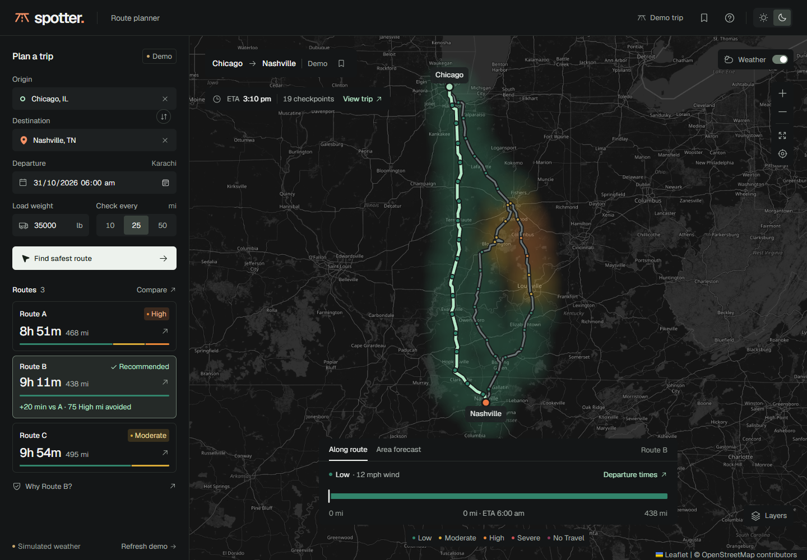

# Spotter · Route intelligence

A weather-aware truck-route planner built with **React, TypeScript, Django, and
Leaflet**. Compare real road options against the forecasts a driver is expected
to encounter, including the effect of load weight on wind risk.

**[Open the hosted application](https://spotter-route-intelligence.vercel.app)**
· [GitHub source](https://github.com/ArhumKhan10/spotter-route-intelligence)



## Run locally

Requires Python 3.12+ and Node 22+. No API keys or database are needed.

```powershell
python -m venv .venv
.\.venv\Scripts\python.exe -m pip install -r backend/requirements.txt
npm.cmd --prefix frontend ci
npm.cmd --prefix frontend run build
.\.venv\Scripts\python.exe backend/manage.py collectstatic --noinput
.\.venv\Scripts\python.exe backend/manage.py runserver
```

Open **http://127.0.0.1:8000**. On macOS/Linux, use `.venv/bin/python` and `npm`.
For hot reload, start Django on port 8000 and `npm --prefix frontend run dev`
in another terminal; Vite proxies `/api` to Django.

The initial **example trip** contains real cached Chicago–Nashville OSRM road
geometries with **explicitly simulated weather**. Click **Find safest route**
for live forecasts, or search and select different cities. Example mode never
silently replaces a failed live request. Use **Refresh** beside the example
label to explore load or checkpoint-spacing changes in the example scenario.

## What is implemented

- Origin/destination city search, departure with explicit time zone, load in
  pounds, and 10/25/50 mile checkpoint spacing.
- Up to three distinct, genuine OSRM road options. When native alternatives are
  limited, intermediate waypoints request additional roads. A warning explains
  cases where fewer than three distinct options exist.
- Weather at every checkpoint’s **estimated arrival time**, including origin
  and destination. ETAs integrate per-road-segment duration, normalized to the
  routing provider’s total to account for turns.
- Exact weather thresholds and load rules, conservative risk-mile estimates,
  and a transparent, deterministic route recommendation.
- Interactive routes, all checkpoint markers, ETA/weather tooltips, a checkpoint
  detail panel, comparison view, and a complete checkpoint table.
- A canvas-rendered corridor heatmap with a **0–48 hour slider**, playback,
  wind/rain/snow layers, overlay toggle, map zoom, and route fitting.
- Responsive mobile layout, keyboard city selection, native modal focus
  trapping, reduced-motion support, and self-hosted fonts.
- JSON trip export and up to five saved trip inputs on the current device.
- Timeouts, validation, request bounds, provider caching, a basic request
  throttle, and actionable upstream error messages.

## Risk and recommendation

| Condition | Low | Moderate | High | Severe | No Travel |
| --- | --- | --- | --- | --- | --- |
| Wind, mph | <25 | 25–<35 | 35–<45 | 45–<55 | ≥55 |
| Rain, in/hr | <0.10 | 0.10–<0.25 | 0.25–<0.50 | 0.50–1.00 | >1.00 |
| Snow, in/hr | <0.5 | 0.5–<1.0 | 1.0–<2.0 | 2.0–3.0 | >3.0 |

The brief overlaps adjacent rain/snow bands at some exact boundaries. This
implementation assigns those shared boundaries to the **higher** risk band;
1.00 in/hr rain and 3.0 in/hr snow remain Severe, as specified.

Load rules use strict weight comparisons:

- Wind ≥55 mph: **No Travel** for all loads.
- Wind ≥45 mph and load **>30,000 lb**: **No Travel**.
- Wind ≥35 mph and load **>40,000 lb**: at least **Severe**.

The highest condition wins. Wind uses 10 m **gusts**, a documented conservative
interpretation of the brief’s wind measurement. Rain includes rain + showers,
converted from mm to inches. Snowfall is converted from cm to inches.

Each interval between checkpoints inherits the worse endpoint risk. Its whole
road mileage is assigned to that band, so risk miles sum to route distance.
Average risk is distance-weighted using levels 0–4. These are estimated risk
miles between samples, not measurements of every road segment.

Routes with any No Travel checkpoint are **excluded**. Remaining routes are
ranked lexicographically by `(Severe miles, High miles, average risk, duration)`.
If all routes are excluded, **none is recommended**.

The forecast slider and recommendation intentionally represent different
questions: the slider displays the entire corridor at one fixed forecast time,
while route risk always follows the driver’s changing checkpoint ETA. Slider
changes do not recalculate or mislabel a route recommendation.

## Tests

```powershell
.\.venv\Scripts\python.exe backend/manage.py test routing
npm.cmd --prefix frontend run build
# With the built Django app running on port 8000:
npm.cmd --prefix frontend run test:e2e
```

The backend suite checks all threshold edges, strict load boundaries, missing
weather, ranking priorities, blocked routes, unit conversion, time zones,
nonuniform segment speeds, endpoint sampling, validation, HTTP errors, and the
full example pipeline. Playwright runs desktop and mobile flows using Microsoft
Edge. Set `PLAYWRIGHT_BASE_URL` to test a deployed app. For another browser,
change `channel` in `frontend/playwright.config.ts`.

## Architecture and APIs

```text
frontend/src/             React workspace, map, city search, accessible dialogs
backend/config/          Django configuration and production WSGI entrypoint
backend/routing/risk.py   Pure risk thresholds, mileage, and ranking
backend/routing/sampling.py  Road distance + segment time interpolation
backend/routing/providers.py OSRM and Open-Meteo adapters, caching, batching
backend/routing/service.py   Checkpoint + corridor forecast orchestration
backend/routing/demo.py      Explicit synthetic scenario on cached road geometry
```

| Endpoint | Purpose |
| --- | --- |
| `GET /api/health/` | Health check |
| `GET /api/geocode/?q=Chicago` | City suggestions |
| `GET /api/demo/?interval=25&load=35000` | Labeled example scenario |
| `POST /api/plan/` | Calculate live road/weather options |

Example request:

```json
{
  "origin": {"name": "Chicago, IL", "lat": 41.8781, "lon": -87.6298},
  "destination": {"name": "Nashville, TN", "lat": 36.1627, "lon": -86.7816},
  "departure": "2026-10-31T08:00:00-05:00",
  "load_lb": 35000,
  "interval_miles": 25
}
```

Use a departure within the **next 48 hours**. Coordinates are validated; load
is 0–80,000 lb. To bound public API usage, trips must be under roughly 2,000
miles, and the combined checkpoint/corridor forecast budget is 400 unique
locations. Long trips at 10-mile spacing may require a larger interval.
Requests use up to three parallel weather batches of 40 locations. The
provider cache lasts 10 minutes for weather and 24 hours for roads/geocoding.
No shared user records are stored; saved trips remain in browser storage.

## Deployment

**Vercel:** `vercel.json` deploys Django and Vite as two services behind one
origin: `/api/*` reaches Python, and React assets are served from the CDN.
Set `DJANGO_SECRET_KEY` to a long
random value. Production/debug and writable `/tmp` cache configuration are in
the deployment manifest. Vercel hostnames are discovered from its environment.

**Docker/Render:** the multistage Dockerfile builds React and serves it with
Django/WhiteNoise and Gunicorn. `render.yaml` includes a health check and secret
generation. Set `DJANGO_DEBUG=0`, `DJANGO_SECRET_KEY`, and
`DJANGO_ALLOWED_HOSTS` for other hosts. `RENDER_EXTERNAL_HOSTNAME` is discovered
automatically. Environment variable examples are in `.env.example`; the app
reads the process environment, so load/export these values with your platform.

```sh
docker build -t spotter .
docker run --rm -p 8000:8000 -e DJANGO_DEBUG=0 -e DJANGO_SECRET_KEY=replace-with-a-random-secret -e DJANGO_ALLOWED_HOSTS=localhost,127.0.0.1 spotter
```

## Limits and next steps

OSRM’s public **driving** profile is not a truck-compliance engine: it does not
check dimensions, axle/bridge weights, hazmat restrictions, hours-of-service,
or traffic. ETAs exclude stops and driver breaks. Use a commercial truck
routing profile for dispatch. The assessment explicitly permits third-party
routing; the weather/load risk rules are implemented independently.

Public OSRM/Open-Meteo services may rate-limit or be temporarily unavailable.
For production traffic, use contracted services or self-host OSRM, a shared
Redis cache/atomic throttle, background jobs, and a supported map tile plan.
The included file cache and per-client throttle are intentionally lightweight
and are not a distributed abuse-prevention system. Serverless cache contents
are ephemeral. No authentication is needed for this stateless assessment app.

## Sources and credits

- [OSRM routing API](https://project-osrm.org/docs/v5.24.0/api/)
- [Open-Meteo forecast and unit documentation](https://open-meteo.com/en/docs)
- [Open-Meteo geocoding API](https://open-meteo.com/en/docs/geocoding-api)
- [OpenStreetMap data and map tiles](https://www.openstreetmap.org/copyright)
- [OSM tile usage policy](https://operations.osmfoundation.org/policies/tiles/)
- Geist fonts (SIL Open Font License), Phosphor icons (MIT), Leaflet (BSD-2-Clause)

See [the walkthrough script](docs/LOOM_SCRIPT.md) for a 5–10 minute demo outline.
