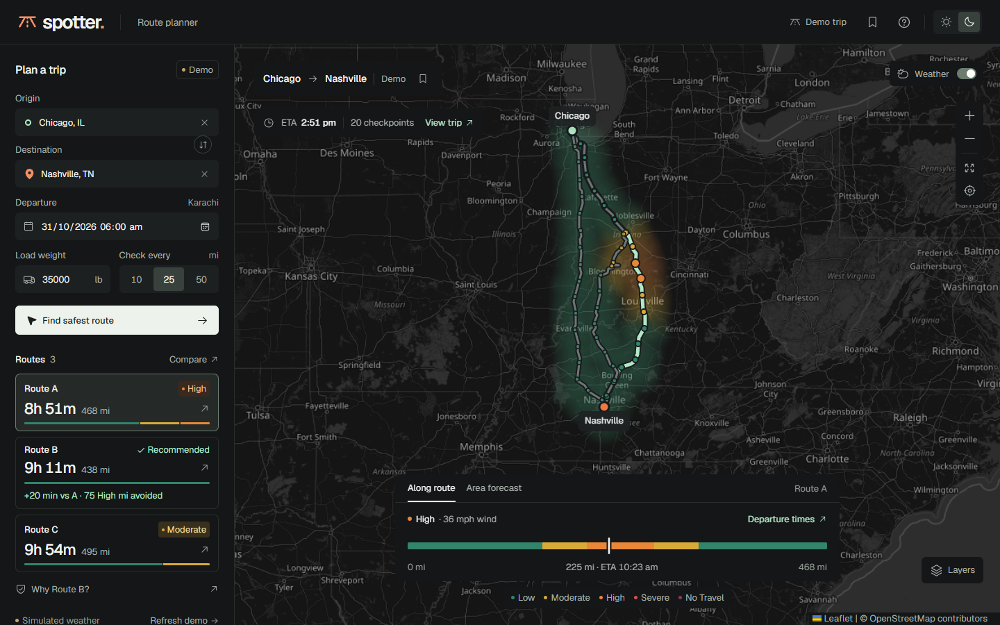
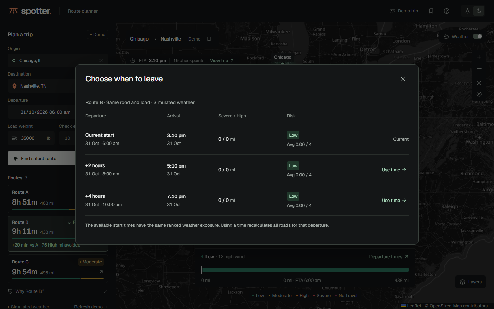
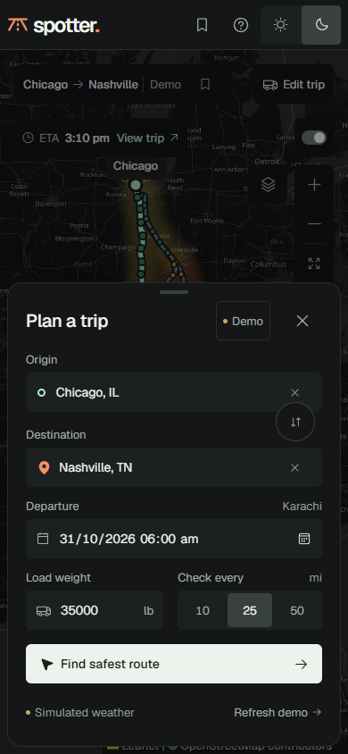
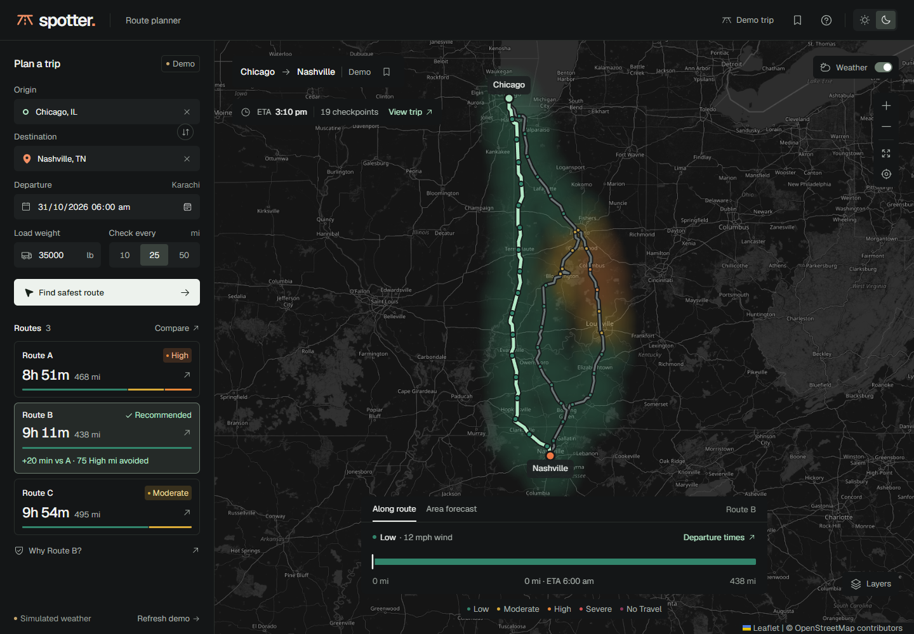
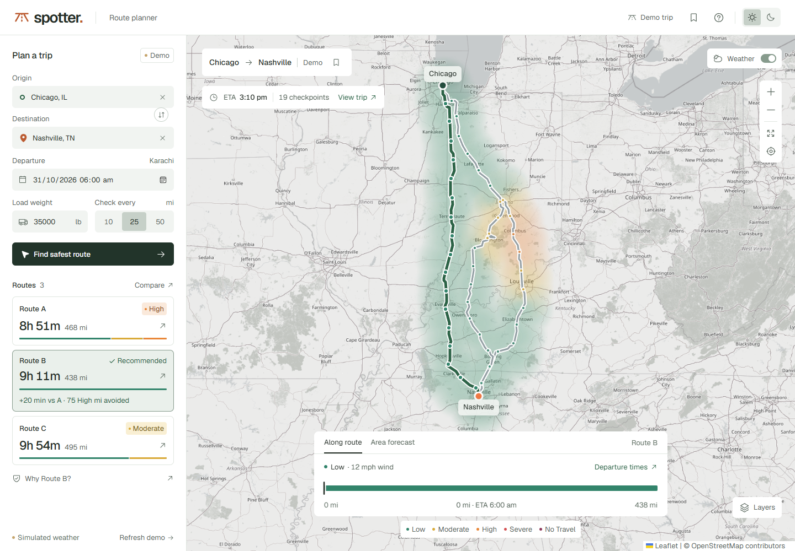

# Visual review

## Current route insights and phone improvements

The accepted improvement pass keeps the existing Taste Skill `true-black-flat`
direction, seed 1683639963, and the shared light/dark tokens. No style redraw
was needed. The new signature is a thin journey weather strip drawn from actual
checkpoint intervals, with a compact recommendation tradeoff against the fastest
road. The strip supports pointer inspection and keyboard navigation.

The map stays visible behind the phone's focused trip-editing sheet. Its repeated
route list is removed, primary map/header controls have 44px targets, and route
risk has visible text labels. Focus remains inside the sheet until it closes,
then returns to Edit trip. The area forecast lives in a separate tab from
arrival-time weather. Comparison hides shared zero bands behind a real control.

Departure comparison is an on-demand dialog. Current, +2 hour, and +4 hour starts
are evaluated with the same already fetched weather and load rules. Missing
forecasts and out-of-window starts remain explicit. Applying a time recalculates
all roads without changing simulated weather into live weather.

Taste Skill's browser inspector reports **0 FAIL and 0 WARN** at 1440, 768, and
390px, with 113 desktop words and 67 phone words. There is no horizontal overflow
and UI type stays at 13px or above. The source linter's six shadow warnings refer
to actual floating menus, tooltips, popovers, dialogs, toasts, and the phone sheet.

Visual review caught overlap between the larger insights panel and View trip,
and between the phone's area forecast and Layers. The trip summary now sits
under the map's city context, and Layers is beside the phone's zoom controls.

App-screen critique: the map answers which road to choose and remains the
largest element. Sidebar and comparison edges align, and the phone receives
its own form sheet. Color identifies road selection, weather severity, or
status. The displayed 20-minute delta is 551 minus 531 rounded driving minutes;
the 75 High-mile benefit is 75 minus zero on the same baseline road. Risk-mile
totals come from checkpoint intervals. Shared zeros can be revealed, while
unavailable future weather has a reason instead of a zero. Legends retain their
units and weather marks; the phone has text risk labels. The final review found
no overlapping main controls after the two placement fixes. Dense geographic
labels remain part of the real basemap rather than invented interface content.
The phone tradeoff has an opaque theme surface so basemap labels do not run
behind its text in light mode.

## Map workspace and theme foundation

The latest revision follows the user's request for a visual interface with
less text and a complete dark mode. Taste Skill's drawn direction is
`true-black-flat`, seed 1683639963. The earlier light framed-sheet direction
was replaced because the user rejected its density and requested dark mode.

The default screen is now the map, with a compact trip panel and three route
choices. On phones, trip editing is a separate view opened with **Edit trip**.
The recommendation evidence is available through **Why Route B?**, and the
full risk rules remain behind Help. No explanatory paragraphs are shown on
the main map screen. The inspector measured 90 visible words, compared with
roughly 270 in the previous layout.

Both themes use explicit surface, text, control, and risk-state tokens. Theme
selection persists across reloads, is applied before React mounts, and sets
the browser color scheme. Basemap raster tiles receive a separate grayscale
dark treatment; route lines, checkpoints, and forecast colors keep their
semantic meaning. Dialogs, city search, errors, saved trips, tables, and
exports retain their functionality in both themes.

The map is created after its first route is ready and starts at that trip's
actual bounds. This avoids requesting and canceling an unrelated batch of
initial map tiles. Only on-screen tile buffers are requested. Screenshots
wait for the visible basemap tiles to complete loading. A stalled tile is
retried once after 12 seconds using the same cacheable URL.

The current Taste Skill browser inspector reports **0 FAIL and 0 WARN** at
1440, 768, and 390px. The main view has no horizontal overflow and keeps all
UI text at 13px or larger.

Em dashes were removed from app copy and documentation. Regression checks
cover limited visible copy, on-demand help, dark/light persistence, modal
surfaces, and the absence of em dashes in the rendered screen and title.

## Previous design iterations

## Taste Skill redesign

The official current `design-taste-frontend` skill was installed from
[Leonxlnx/taste-skill](https://github.com/Leonxlnx/taste-skill), read, and used
with its dedicated app-screen workflow. The drawn direction is **framed-sheet**,
seed **1933074152**, with no redraws. Existing Geist typography and semantic
risk colors were retained. The pale green-grey frame comes from the navigation
and weather subject; the real road map supplies the main visual content.

The screen asks: **Which route has the least dangerous weather for this load?**
Its signature element is the group of three routes with distance-proportional
risk bars, backed by actual Severe/High mileage and the time cost of the
recommendation.

The redesign removes the dark icon rail, pretend account avatar, marketing
slogans, tiny text, and separate nested route cards. All three options are now
grouped together under the map. Example data gets a readable source notice,
and “Why Route B?” explains the weather evidence and the extra driving time.
All UI text is at least 13px, with tabular figures. Shared time differences
are calculated from the same rounded minutes used in displayed durations.

### Measured and visual checks

Taste Skill's actual `lint.mjs --app` and `inspect.mjs --app` were run. The
browser inspector reports **0 FAIL** at 1440, 768, and 390px, with no small-text
warning after the second pass. Source shadow warnings refer to real floating
menus, tooltips, loading popovers, the modal, and toast. They are permitted by
the app-screen guidance; resting route panels have no shadow.

One layout warning flags unequal bordered-panel heights in the planner/map
columns. The planner is a stack of a form, a data-source notice, and unboxed
recommendation evidence; the results column is a map, forecast control, and
route comparison. Their outer grid edges align, while the individual panels
retain the heights their different jobs require.

The rendered screenshots were reviewed at all three widths. The screen's
question is answered by the map and adjacent route data; risk colors encode
the assessment's five bands rather than decorate the chrome. All counts and
risk mileage come from the response. Both endpoints remain clear of the trip
summary. On tablets the summary moves below the map; on phones the planner,
evidence, map, and route options stack with readable labels and no horizontal
page scroll. Example weather remains explicitly synthetic; live planning is
a separate, named action.

## Earlier implementation review

Direction: a map-first dispatch workspace with forest ink, chalk surfaces,
a restrained orange identity, self-hosted Geist, and weather colors reserved
for actual risk. The road and checkpoint data supply the imagery. The
installed high-end-visual-design and minimalist-ui skills informed typography,
surfaces, and interactions. Marketing-page layouts were not applied to this
product screen.

The first browser review caught a tile provider returning API-key notices
and mobile icon controls losing their names when text was hidden. The app
now uses attributed OpenStreetMap tiles and explicit accessible labels.

Desktop and mobile screenshots are reviewed for overflow, legibility, map
controls, and complete flows. Desktop planner content scrolls independently
when screen height is limited. Mobile follows a natural sequence of planner,
map, and route options. Map colors are reinforced by text labels, and all
checkpoint data is available in an HTML table. Heatmap rendering uses one
low-resolution canvas while roads and checkpoints remain crisp vector layers.
Reduced-motion preferences disable interface transitions.

The final pass moves the phone trip summary below the map and narrows the
desktop summary, keeping the destination marker unobstructed. A browser
regression assertion checks the destination label against the summary bounds.
Route fitting also updates when the map resizes.
