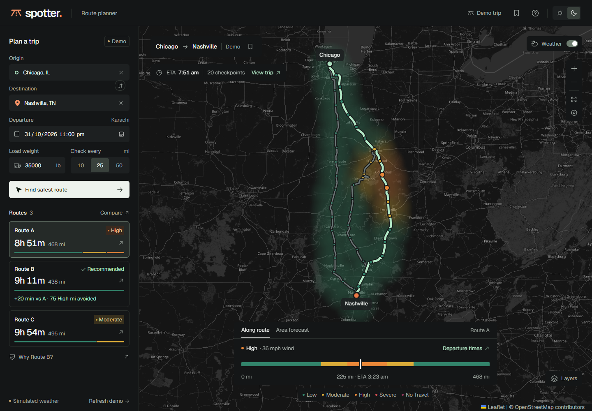
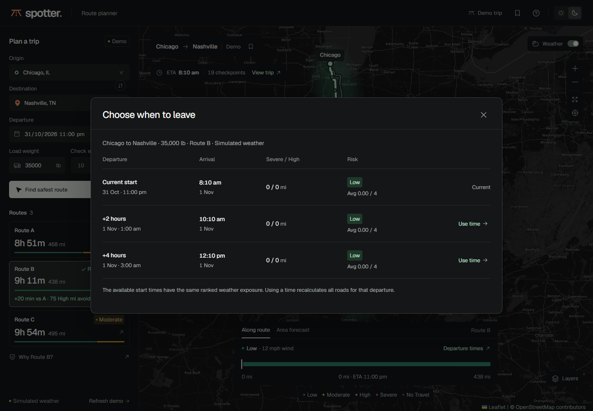

# Using Spotter

[Open the application](https://spotter-route-intelligence.vercel.app)
· [Project documentation](../README.md)

## Explore the demo

The app opens with a Chicago–Nashville trip using real road geometry and
clearly labeled simulated weather. Route A is faster, while recommended
Route B avoids its High-risk weather exposure.

- Select a route card or a road on the map to highlight it.
- Open **Why Route B?** for the recommendation evidence.
- Choose **Compare** for driving time and weather mileage side by side.
  **Show all risk bands** reveals categories shared at zero miles.
- Choose **View trip** for checkpoint arrival times, weather, and JSON export.
- On a phone, **Edit trip** opens the input sheet. Close it with the X, Escape,
  or the backdrop to return to the map.

Change load or checkpoint spacing and choose **Refresh demo** to explore the
example scenario. **Demo trip** restores the example cities.

## Plan a live trip

1. Enter an origin and destination, selecting each city from the search results.
2. Choose a departure within the next 48 hours. The field uses your device's
   time zone, shown beside its label.
3. Enter the truck's load in pounds and choose 10, 25, or 50 mile checkpoints.
4. Select **Find safest route** to request road alternatives and live forecasts.

The **Live** label identifies live results. Provider failures show an error
and preserve the previous results with their original data label.

## Inspect weather along the road

At the bottom of the map, select **Along route**. The colored horizontal strip
shows weather risk by road distance at the truck's expected arrival times.

Hover over the strip to preview weather. Click to inspect a checkpoint on the
map, or focus the strip and use arrow keys, Home, End, Page Up, or Page Down.
Each interval uses the worse risk of its two endpoints, matching the mileage
shown in the comparison.

## Preview area weather

Select **Area forecast** beside **Along route**. Its 0–48 hour slider previews
the corridor at one selected time. Play/pause animates the forecast, and
**Layers** switches between combined risk, wind gusts, rain, and snow.

This area preview does not change the recommendation. Route ranking continues
to use the expected arrival time at each checkpoint.

## Compare departure times

Under **Along route**, select **Departure times** above the colored strip on
the right. It compares the selected road and load at the current start,
two hours later, and four hours later.

The comparison uses the same fetched forecasts and load rules. It shows
arrival time, Severe/High mileage, and average risk. Later is not always better:
missing forecasts and starts outside the 48-hour window are unavailable, while
No Travel conditions remain explicit.

**Use time** recalculates all roads for that departure, so the recommended
road may change. Demo trips continue to use simulated weather.

## Appearance and saved trips

Use the sun and moon controls in the top-right corner to select light or dark
mode. Your choice persists on this device. The bookmark above the map saves
the current trip inputs; the header bookmark opens saved trips.

Public OSRM driving routes do not validate truck clearances or restrictions.
ETAs exclude traffic, stops, and breaks. See the [project limitations](../README.md#limitations).
